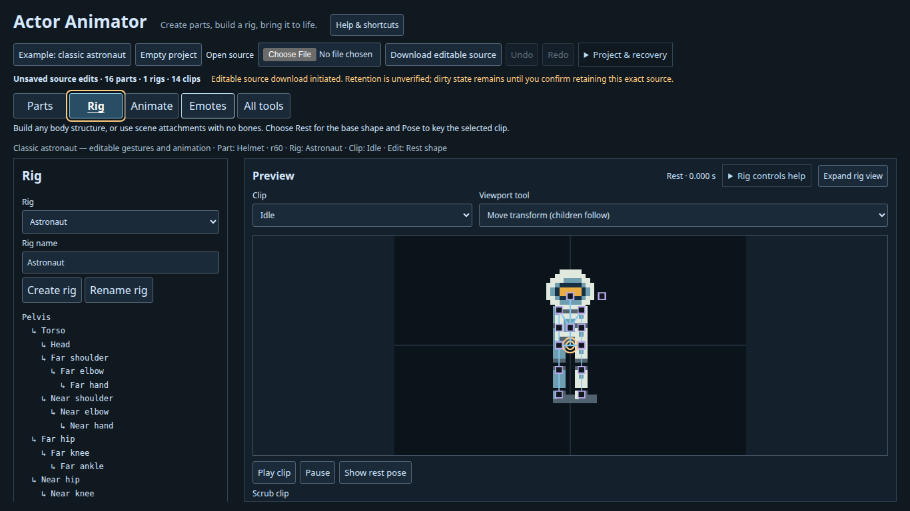
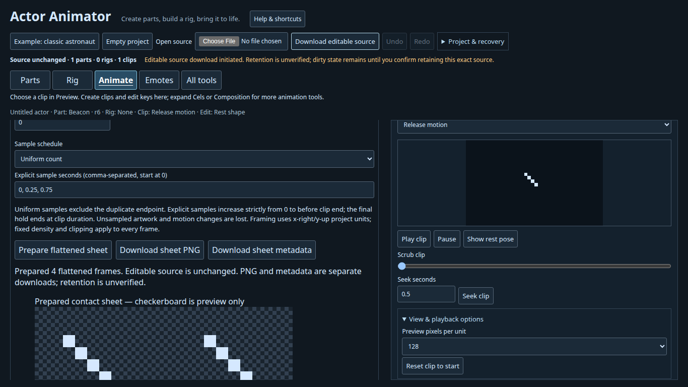

# Create and keep an actor

Open the editor and choose **Help & shortcuts** for an offline copy of the essentials. A mouse or pen is needed for painting and rectangle selection. Numeric fields support rig transforms and key timing. A desktop or laptop is recommended; narrow windows support navigation but are not a qualified phone authoring interface.

## Character: start from the example

1. Choose **Projects → Examples → Example: classic astronaut**, then **Rig**. Select a clip in Preview and use **Play clip**, **Pause** or the seconds slider. **Show rest pose** returns to the base shape.
2. In **Parts**, select a part and paint or adjust **Pivot & pixel scale**. Editing accepted artwork creates a separate revision. The assembled actor keeps its accepted artwork until you select the attachment in Rig and choose **Accept selected painted part revision**. Select the new part again if selecting the attachment changed your part selection.
3. In **Rig**, select a joint. **Rest** changes its base transform. **Pose** inserts a key in the selected clip at the preview time. Positions are project units, Y up; angles are counterclockwise radians. Numeric controls and viewport tools edit the same source.
4. In **Animate**, create a short clip, choose a track target, and insert keys at explicit seconds. The **Two-key shortcut** is useful for a first motion. Preview and scrub the clip. Use **Undo**, then **Redo**, to review a change.
5. **Download editable source**. Keep the `.actorproject` file and reopen it with **Projects → Open source**. The browser cannot verify that you kept a download: **Project & recovery → I retained this source** acknowledges only the current downloaded source.

## Nonhuman: a floating beacon with no bones

1. Choose **Projects → Empty project**, then **Parts**. Name a part “Beacon”, choose width/height 8×8 and **Create part**. Paint several pixels. In **Pivot & pixel scale**, use 0.125 project units per pixel and pivot X/Y 0.5/0.5.
2. In **Rig**, choose item kind **Part attachment**, leave the parent at scene root, name it “Light”, and **Create item**. A skeleton is optional. To build a creature instead, create a rig and freely named nodes; several scene roots are allowed.
3. In **Animate**, create a 1-second “Float” clip. Expand **Two-key shortcut**, set Key B X to 0.5, and **Apply two keys**. Play and pause the preview. Undo and redo the key edit.
4. Download the editable source, acknowledge retention after keeping it, and reopen it. Layers, pivot, source IDs, rigs and all clips are preserved. Unknown extensions remain inert.
5. Under **Animate → Cels & flipbooks**, find **Flattened sheet and PNG**. Choose frame dimensions, pixels per project unit and framing; **Prepare flattened sheet**. Review the contact sheet and timing. Download **sheet PNG**, **sheet metadata** and **complete editable source** separately.

A sheet samples a clip; it loses editable layers, the rig, continuous curves and composition. Keep PNG and matching metadata together and retain the original source. The [independent sheet consumer](../examples/sheet/index.html) is source for the built `/sheet-example/` demo; use a production build to run it.

## Files, recovery and mistakes

Projects and PNGs are read and processed in the browser. No upload, account or analytics code is included. A hosted editor still downloads its application files from the host, which receives ordinary web requests. Built runtime demos fetch their bundled example projects from that host.

Recovery is best effort browser storage under the Actor Animator namespace, not permanent storage, cloud sync or a file backup. Tabs on the same origin share that namespace. GitHub Pages project sites under one owner share an origin; repository paths do not isolate recovery. The offline HTML's recovery behavior depends on browser and file location. Keep downloaded source before clearing browser data or replacing a project.

Invalid imports leave the current source intact. Cancelling a file chooser or a canvas gesture retains the project. Text fields keep native undo; canvas/timeline undo uses Ctrl/Cmd+Z and Ctrl/Cmd+Shift+Z. Escape cancels active gestures, closes help and restores an expanded rig view when focus is outside its canvas. Use Tab / Shift+Tab and Enter / Space for form controls. The selected task has an underline and pressed state as well as a colour change.
